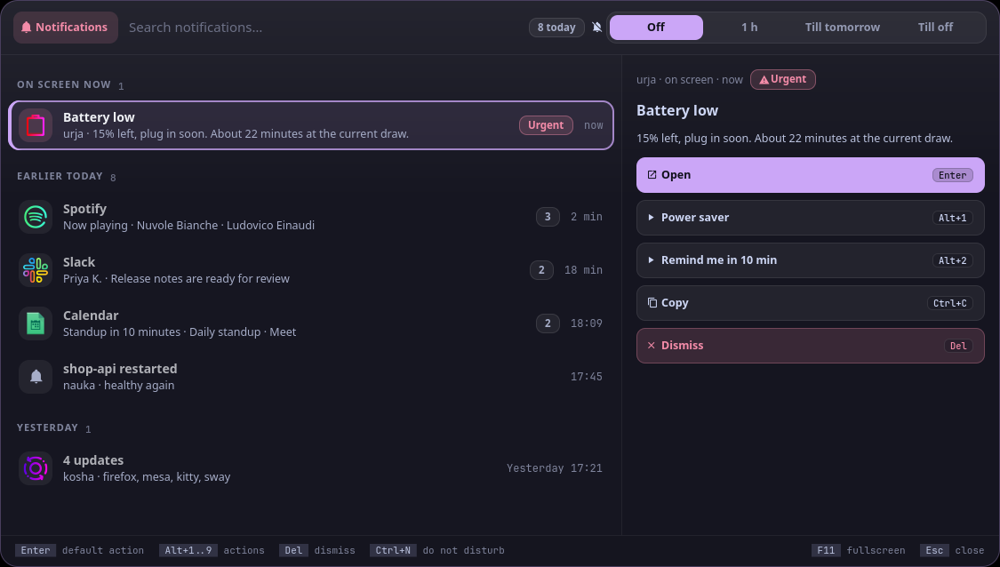

<p align="center">
  <picture>
    <source media="(prefers-color-scheme: dark)" srcset="assets/banner-dark.svg">
    <source media="(prefers-color-scheme: light)" srcset="assets/banner-light.svg">
    
  </picture>
</p>

<!-- identity -->
<p align="center">
  <b>पथि प्रग्रहिणं कंसमाभाष्याहाशरीरवाक् ।<br>
  अस्यास्त्वामष्टमो गर्भो हन्ता यां वहसेऽबुध ॥</b><br>
  <i>On the road, a bodiless voice spoke to Kamsa, who held the reins.</i><br>
  <sub>Bhāgavata Purāṇa 10.1.34</sub>
</p>
<!-- /identity -->

<p align="center">
  <b>Notifications (mako): what's on screen with its actions, each app's history stacked with times, a full preview, do not disturb for a while.</b><br>
  Notifications. A tool for <a href="https://github.com/Theyashsawarkar/vyom">Vyom</a>, keyboard-driven panels for Wayland.
</p>

<p align="center">
  <a href="https://github.com/Theyashsawarkar/akashvani/actions/workflows/ci.yml"></a>
  <a href="https://github.com/Theyashsawarkar/akashvani/releases"></a>
  <a href="LICENSE"></a>
  <a href="https://github.com/Theyashsawarkar/vyom"></a>
  
  
</p>

<!-- No screenshot: notifications shows personal data (your own notifications). -->

<p align="center">
  
</p>
<p align="center"><sub>Screenshots use made-up demo notifications.</sub></p>

> *Akashvani* (आकाशवाणी) is Sanskrit for "voice from the sky": the notices your apps send you.

akashvani is notifications for [Vyom](https://github.com/Theyashsawarkar/vyom): one keyboard-driven panel that opens instantly, with live data, a preview and a key for everything. It runs on any compositor with the layer-shell protocol (sway, Hyprland, river, niri, Wayfire, labwc…). In [Vayu](https://github.com/Theyashsawarkar/vayu), the desktop it was built for, it replaces notification-history.py.

## Contents

- [Features](#features)
- [Install](#install)
- [Usage](#usage)
- [Configuration](#configuration)
- [Troubleshooting](#troubleshooting)
- [The Vyom family](#the-vyom-family)
- [Contributing](#contributing)
- [License](#license)

## Features

- What's **on screen now**, urgent ones first with a red **Urgent** chip, with the actions each offers.
- The history with **each app's notifications stacked into one row** with a count (Enter opens the stack), under Earlier today, Yesterday and Older.
- **A time on every row** ("now", "2 min", "09:41"): akashvani notes when each notification arrives (mako keeps no times).
- The preview shows the whole message and its **actions as buttons**, numbered `Alt+1..9`, with Copy and a red Dismiss.
- **Do not disturb for an hour, till tomorrow morning, or till you turn it off**, in the header; a timer turns it off again even with the panel closed, and the panel says how many notifications it's holding.
- Keyboard first: every action has a key, shown in the footer; the mouse works too.
- Never freezes the panel: slow commands run in the background.

## Install

### Requirements

- [Vyom](https://github.com/Theyashsawarkar/vyom) 0.6.0 or newer (Python 3.11+, PyGObject, GTK 4, [gtk4-layer-shell](https://github.com/wmww/gtk4-layer-shell), a Nerd Font)
- `makoctl`

### Install

```sh
git clone https://github.com/Theyashsawarkar/akashvani ~/.local/share/vyom/plugins/akashvani
vyom reload           # pick it up (or log out and in)
vyom akashvani            # open it; run it again to close
```

Give it a key in your compositor, e.g. sway:

```sh
bindsym $mod+<key> exec vyom akashvani
```

### Update and uninstall

```sh
git -C ~/.local/share/vyom/plugins/akashvani pull && vyom reload     # update
rm -rf ~/.local/share/vyom/plugins/akashvani && vyom reload          # uninstall
```

## Usage

Open it with `vyom akashvani` (or your key). Type to search; the footer always shows the keys for what's selected.

| Key | Action |
|---|---|
| `Enter` | Run the notification's default action (or open an app's stack, or copy it) |
| `Alt+1..9` | Run that numbered action of the notification |
| `Ctrl+C` | Copy the notification's text |
| `Delete` | Dismiss the on-screen notification |
| `Ctrl+Backspace` | Dismiss every notification on screen |
| `Ctrl+N` | Cycle do not disturb: off, 1 hour, till tomorrow, till you turn it off |
| `Esc` | Close the panel |

Every Vyom panel also has `Up`/`Down` (or `Ctrl+K`/`Ctrl+J`) to move and `Page Up`/`Page Down` to jump. Each tool opens from its own key.

## Configuration

Everything is optional, in `~/.config/vyom/config.toml` under `[plugin.akashvani]`:

| Setting | Default | What it does |
|---|---|---|
| `dnd_status` | (makoctl mode) | Command printing the current mode |
| `dnd_on_when` | ^dnd$ | Regex: do not disturb is on |
| `dnd_on / dnd_off` | (makoctl mode -a/-r) | Commands to turn it on / off |
| `dnd_morning` | 08:00 | When "till tomorrow" ends |

A timed do not disturb is a systemd user timer (`systemctl --user list-timers akashvani-dnd-off.timer`), or a detached `sleep` without systemd.

Run `vyom reload` after editing.

## Troubleshooting

- **Nothing opens.** `vyom list` shows every installed tool, and why one is skipped (a missing requirement, or a Vyom that's too old).
- **It opened, then something failed.** Look for a `Traceback` in the daemon's log, `journalctl --user -u vyom -u vyom-daemon -b` (without systemd: `~/.local/state/vyom/daemon.log`), and [open an issue](https://github.com/Theyashsawarkar/akashvani/issues/new/choose) with it.
- **No blur or rounded corners.** That's the compositor: on SwayFX, add `layer_effects "vyom" { blur enable; corner_radius 20; shadows enable }`.

## The Vyom family

Each tool is its own repository, so you install only the ones you want:

| Tool | | What it does |
|---|---|---|
| [dvara](https://github.com/Theyashsawarkar/dvara) | द्वार, gateway | The app launcher |
| [ganit](https://github.com/Theyashsawarkar/ganit) | गणित, mathematics | The calculator and converter |
| [smriti](https://github.com/Theyashsawarkar/smriti) | स्मृति, memory | Clipboard history |
| [bhava](https://github.com/Theyashsawarkar/bhava) | भाव, feeling, emotion | The emoji picker |
| [tarang](https://github.com/Theyashsawarkar/tarang) | तरंग, wave | Wi‑Fi and the hotspot |
| [setu](https://github.com/Theyashsawarkar/setu) | सेतु, bridge | Bluetooth |
| [doot](https://github.com/Theyashsawarkar/doot) | दूत, messenger | Your phone, through KDE Connect |
| [patra](https://github.com/Theyashsawarkar/patra) | पात्र, vessel | Docker containers |
| [akashvani](https://github.com/Theyashsawarkar/akashvani) (this one) | आकाशवाणी, voice from the sky | Notifications |
| [raga](https://github.com/Theyashsawarkar/raga) | राग, melody | YouTube music and video |
| [mudra](https://github.com/Theyashsawarkar/mudra) | मुद्रा, gesture | Keybinding search |
| [urja](https://github.com/Theyashsawarkar/urja) | ऊर्जा, energy | The battery at a glance |
| [vishram](https://github.com/Theyashsawarkar/vishram) | विश्राम, rest | The power menu |
| [kendra](https://github.com/Theyashsawarkar/kendra) | केन्द्र, centre | Quick settings |

## Contributing

Bug reports, ideas and pull requests are welcome: see [CONTRIBUTING.md](CONTRIBUTING.md) for the development setup and the few rules every tool follows, and [CHANGELOG.md](CHANGELOG.md) for what changed in each release. Please report security issues privately ([SECURITY.md](SECURITY.md)).

## License

[MIT](LICENSE).
