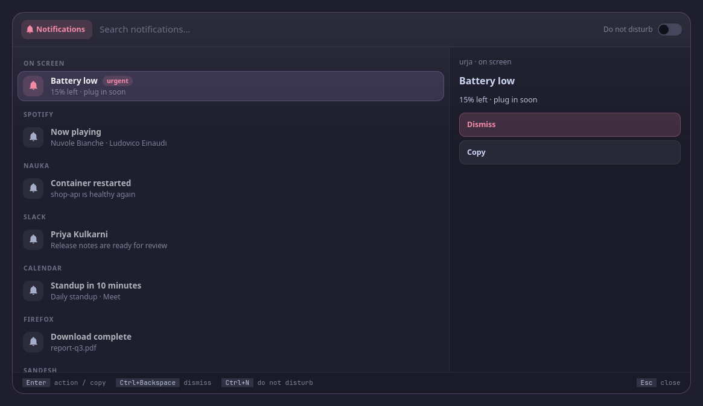
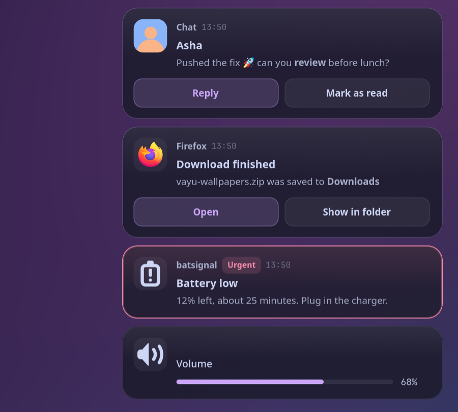

<p align="center">
  <picture>
    <source media="(prefers-color-scheme: dark)" srcset="assets/banner-dark.svg">
    <source media="(prefers-color-scheme: light)" srcset="assets/banner-light.svg">
    
  </picture>
</p>

<!-- identity -->
<p align="center">
  <b>पथि प्रग्रहिणं कंसमाभाष्याहाशरीरवाक् ।<br>
  अस्यास्त्वामष्टमो गर्भो हन्ता यां वहसेऽबुध ॥</b><br>
  <i>On the road, a bodiless voice spoke to Kamsa, who held the reins.</i><br>
  <sub>Bhāgavata Purāṇa 10.1.34</sub>
</p>
<!-- /identity -->

<p align="center">
  <b>Your desktop's notifications: the notification server itself, with beautiful popups in your theme, rules, a history with times and do not disturb, and a keyboard-driven panel for all of it.</b><br>
  Notifications. A tool for <a href="https://github.com/Theyashsawarkar/vyom">Vyom</a>, keyboard-driven panels for Wayland.
</p>

<p align="center">
  <a href="https://github.com/Theyashsawarkar/akashvani/actions/workflows/ci.yml"></a>
  <a href="https://github.com/Theyashsawarkar/akashvani/releases"></a>
  <a href="LICENSE"></a>
  <a href="https://github.com/Theyashsawarkar/vyom"></a>
  
  
</p>

<!-- No screenshot: notifications shows personal data (your own notifications). -->

<p align="center">
  
</p>

<p align="center">
  
</p>
<p align="center"><sub>Screenshots use made-up demo notifications.</sub></p>

> *Akashvani* (आकाशवाणी) is Sanskrit for "voice from the sky": the notices your apps send you.

akashvani is the notification system for [Vyom](https://github.com/Theyashsawarkar/vyom) desktops. It **is the notification server** (it replaces mako or dunst): apps send it notifications over the standard freedesktop D-Bus interface, and it draws them as glass cards in your theme's colours, keeps a history with times, holds them during do not disturb, and gives you one keyboard-driven panel for everything. It runs inside the Vyom daemon that's already resident, so it adds no process of its own. It runs on any compositor with the layer-shell protocol (sway, Hyprland, river, niri, Wayfire, labwc…). In [Vayu](https://github.com/Theyashsawarkar/vayu), the desktop it was built for, it replaced mako.

```
 apps (Firefox, Slack, notify-send, scripts)
          │  org.freedesktop.Notifications  (D-Bus, the freedesktop spec)
          ▼
 ╭─ Vyom daemon (one resident GTK 4 process) ──────────────────────────╮
 │  akashvani server ── rules ── modes (do not disturb, silent)        │
 │     │      │                                                        │
 │     │      ╰── history (with times, saved) ──╮                      │
 │     ▼                                        ▼                      │
 │  popups (layer-shell, glass cards)     the panel (vyom akashvani)   │
 ╰──────────────▲──────────────────────────────────────────────────────╯
                │  dev.vayu.Akashvani (D-Bus)
        `akashvani` command (scripts, bars, keys)
```

## Contents

- [Features](#features)
- [Install](#install)
- [Usage](#usage)
- [The command](#the-command)
- [Configuration](#configuration)
- [Rules](#rules)
- [Styling](#styling)
- [Troubleshooting](#troubleshooting)
- [The Vyom family](#the-vyom-family)
- [Contributing](#contributing)
- [License](#license)

## Features

**The popups**

- **Glass cards in your theme**: rounded, blurred where the compositor blurs (SwayFX), in the colours of your theme (Vyom's `@base`, `@accent`, `@red`…), so a theme change restyles them too.
- **What it means, at a glance**: urgent ones get a red frame and an Urgent chip, low ones stay quiet; a rule can tint an app's cards.
- **The notification's image** (a contact's photo, a screenshot) or its icon, the app and the time, the title, the body with its bold, italics and links made safe.
- **Actions are buttons on the card**; a click runs the default action, right click dismisses, middle click dismisses all.
- **A bar for a value**: volume and brightness keys (and downloads) show one card that moves in place, never a pile, and stay out of the history.
- **Hover holds a card** on screen; it slides in and out; more than `max_visible` wait behind a "+N more" pill (an urgent one never waits).
- Every part has a CSS class, so you can restyle any of it ([Styling](#styling)).

**The server**

- The freedesktop notification spec (1.2): replacing a notification, actions, images, urgency, categories, sounds, resident and transient ones.
- **Rules** per app, title, urgency, category or mode: how long it stays, hide it, mute it, keep it out of the history, tint it ([Rules](#rules)).
- **Modes**: `dnd` / `do-not-disturb` hold popups (urgent ones still show) and mute sounds, `silent` only mutes; they survive a restart, and a timed do not disturb turns itself off.
- **A history with times**, saved across restarts (200 by default).
- **The `akashvani` command**, with makoctl's commands and JSON, so scripts and bars written for mako keep working ([The command](#the-command)).
- Light: no process of its own (it lives in the resident Vyom daemon), one window for every popup, hidden when there are none.

**The panel** (`vyom akashvani`)

- What's on screen now, urgent ones first, held ones marked, with the actions each offers.
- The history with **each app's notifications stacked into one row** with a count (Enter opens the stack), under Earlier today, Yesterday and Older, with a time on every row.
- The preview shows the whole message and its **actions as buttons**, numbered `Alt+1..9`, with Copy and a red Dismiss.
- **Do not disturb for an hour, till tomorrow morning, or till you turn it off**, in the header; the panel says how many notifications it's holding.
- Keyboard first: every action has a key, shown in the footer; the mouse works too.

## Install

### Requirements

- [Vyom](https://github.com/Theyashsawarkar/vyom) 0.7.0 or newer (Python 3.11+, PyGObject, GTK 4, [gtk4-layer-shell](https://github.com/wmww/gtk4-layer-shell), a Nerd Font)
- Optional: `pw-play` (PipeWire), `paplay` or `aplay` for a sound

### Install

```sh
git clone https://github.com/Theyashsawarkar/akashvani ~/.local/share/vyom/plugins/akashvani
ln -s ~/.local/share/vyom/plugins/akashvani/bin/akashvani ~/.local/bin/akashvani   # the command
vyom reload           # pick it up (or log out and in)
vyom akashvani        # open the panel; run it again to close
```

With [kosha](https://github.com/Theyashsawarkar/kosha): `kosha install akashvani` does all of it.

**Make it your notification server.** Only one program can be, so stop the old one (mako, dunst, swaync) and remove it from your compositor's startup:

```sh
systemctl --user disable --now mako.service   # or: pkill mako; pkill dunst
akashvani doctor                               # ✓ akashvani serves notifications
```

akashvani waits in line while another daemon holds the name and takes over the moment it exits; until then the panel reads mako through `makoctl`, as before.

**Start it on the first notification.** If an app sends a notification before Vyom has started, D-Bus starts whichever daemon claims the name, which may be mako. This file makes it start Vyom instead:

```sh
mkdir -p ~/.local/share/dbus-1/services
cp ~/.local/share/vyom/plugins/akashvani/dbus/org.freedesktop.Notifications.service ~/.local/share/dbus-1/services/
```

Give the panel a key in your compositor, e.g. sway:

```sh
bindsym $mod+<key> exec vyom akashvani
```

### Update and uninstall

```sh
git -C ~/.local/share/vyom/plugins/akashvani pull && vyom reload     # update
rm -rf ~/.local/share/vyom/plugins/akashvani && vyom reload          # uninstall (start mako again)
```

## Usage

Open it with `vyom akashvani` (or your key). It opens in normal mode, so stray typing changes nothing: every key is a command and `Space` is the leader (a strip shows what comes next); `/` searches. The footer always shows the keys for what's selected.

<!-- KEYS (generated by scripts/keybinds.py from akashvani/vim.py) -->

Vyom's keys work too (every vim tool has them): `?` and `Space ?` list every key, `Space Space` is the palette, `j` / `k` move, `gg` / `G` jump, `/` searches again, `H` / `L` switch tabs, `q` closes, `Space u f` is fullscreen, `Esc` steps back.

**Normal mode (akashvani opens in it)**

| Key | Action |
|---|---|
| `Enter` | Run the notification's default action (or open an app's stack, or copy it) |
| `h` | Fold the app's stack |
| `l` | Open the app's stack |
| `d d` | Dismiss the on-screen notification (it stays in the history) |
| `u` | Bring back the last dismissed notification |
| `y y` | Copy the notification's text |

**Both modes**

| Key | Action |
|---|---|
| `Alt+1..9` | Run that numbered action of the notification |
| `Ctrl+N` | Cycle do not disturb (off, 1 hour, till tomorrow, till you turn it off) |

**Leader (Space)**

| Key | Action |
|---|---|
| `Space x 1..9` | Run that numbered action of the notification |
| `Space n n` | Cycle do not disturb (off, 1 hour, till tomorrow, till you turn it off) |
| `Space n o` | Turn do not disturb off |
| `Space n h` | Turn do not disturb on for an hour |
| `Space n t` | Turn do not disturb on till tomorrow morning |
| `Space n a` | Turn do not disturb on till you turn it off |
| `Space d d` | Dismiss the on-screen notification |
| `Space d a` | Dismiss every notification on screen (asks first) |
| `Space f l` | Show only what's on screen now |
| `Space f h` | Show only the history |
| `Space f a` | Show only the selected notification's app |
| `Space f c` | Clear the filter (show everything) |
| `Space y y` | Copy the notification's text |
| `Space y b` | Copy the notification's body only |

<!-- END KEYS -->


## The command

`akashvani` controls the server from a shell, a bar or a key. Its commands and JSON are makoctl's, so a script written for mako works with `makoctl` changed to `akashvani`; while mako still holds the name, `akashvani` passes every command to `makoctl`.

| Command | What it does |
|---|---|
| `akashvani list [-j]` | What's on screen now (held ones too), newest first |
| `akashvani history [-j]` | Closed ones, newest first; `--clear` empties it |
| `akashvani count` | How many are in the history |
| `akashvani dismiss [-n ID \| -a]` | Dismiss the newest, that one, or all |
| `akashvani restore` | Bring back the last one you dismissed |
| `akashvani invoke [-n ID] [ACTION]` | Run an action (`default` without one) |
| `akashvani menu [-n ID] PROG [ARGS]` | Pick an action with a picker (`akashvani menu vyom dmenu -p Action`) |
| `akashvani mode [-s M… \| -a M \| -r M \| -t M]` | Show, set, add, remove or toggle modes (`dnd`, `silent`, yours) |
| `akashvani key KEY` | Act on the focused popup: `enter` (its main action; answers a call), `1` `2` `3` (its buttons), `dismiss` (declines a call), `next` (focus the next card), `dismiss-all` |
| `akashvani status [-j]` | On screen, held, history, modes |
| `akashvani reload` | Re-read the popups' settings |
| `akashvani doctor` | Is akashvani the server? What's missing? |

The JSON has makoctl's keys (`id`, `app_name`, `app_icon`, `summary`, `body`, `urgency`, `actions`, `category`, `desktop_entry`) plus `t` (when it arrived), `held`, `value` and `image_path`. Bars can listen for the spec's `NotificationClosed` signal, and for `dev.vayu.Akashvani.Changed` (modes).

## Configuration

Everything is optional, in `~/.config/vyom/config.toml` under `[plugin.akashvani]`; run `vyom reload` after editing.

**The popups**

| Setting | Default | What it does |
|---|---|---|
| `position` | `top-right` | `top-right`, `top-left`, `top-center`, `bottom-right`, `bottom-left`, `bottom-center` or `center` |
| `margin_x` / `margin_y` | 16 / 12 | Distance from the screen's edges (px) |
| `osd_position` | (none) | Where sliders go (a `value` hint or a sync tag: volume, brightness), when they should sit apart from the rest, e.g. notifications `top-center` under the bar's clock and sliders `top-right`. Any other setting can be given again with `osd_` for the sliders alone (`osd_width`, `osd_margin_x`, `osd_max_visible`…) |
| `width` | 400 | A card's width (px) |
| `gap` | 10 | Between cards (px) |
| `max_visible` | 3 | Cards at once; the rest wait behind "N more waiting" (calls and urgent ones never wait) |
| `group` | true | Several from one app share one card: the newest in full, older ones as a line each |
| `group_lines` | 2 | Older lines on a shared card |
| `keys` | true | The newest card has the focus, and `akashvani key` acts on it |
| `copy_codes` | true | A one-time code in a notification (OTP, login code) gets a Copy code button |
| `call_timeout` | 120000 | ms a call card stays if the phone never says the call ended |
| `calls_in_dnd` | true | A phone call (ekatva) rings through do not disturb |
| `dnd_summary` | true | When do not disturb ends, one card says what came in, instead of each one |
| `body_lines` | 3 | Lines of body before "…" |
| `max_actions` | 3 | Action buttons on a card |
| `show_time` / `show_actions` | true | Parts of a card you can turn off |
| `animation` | `slide` | `slide`, `fade` or `none` |
| `animation_ms` | 220 | How long it takes |
| `layer` | `top` | `top` (over windows, under Vyom's panels) or `overlay` (over fullscreen windows too) |

**Timing, sound, history**

| Setting | Default | What it does |
|---|---|---|
| `timeout` | 5000 | ms a normal one stays (when the app doesn't say) |
| `timeout_low` | 3000 | ms for low urgency |
| `timeout_critical` | 0 | ms for urgent ones (0: till you dismiss it) |
| `timeout_actions` | 8000 | At least this long when it has actions |
| `ignore_timeout` | false | Ignore how long the app asks for |
| `sound` | (none) | A sound file played for every notification (not in `silent` or `dnd`) |
| `sound_command` | (pw-play, paplay, aplay) | Plays it: the file is added at the end |
| `history_max` | 200 | Notifications kept in the history |
| `history_sync` | false | Keep volume / brightness sliders in the history too |
| `dnd_morning` | 08:00 | When "till tomorrow" ends |
| `server` | true | `false`: don't serve notifications, only the panel over another daemon (makoctl) |

Over another daemon (`server = false`, or while mako still runs), `dnd_status`, `dnd_on_when`, `dnd_on` and `dnd_off` are the commands the panel uses for do not disturb (default: makoctl's modes).

## Rules

Rules change what happens to some notifications. Each `[[plugin.akashvani.rules]]` has match keys (all must fit) and what to do; every matching rule applies, in order, a later one winning.

| Match | Fits when |
|---|---|
| `app`, `summary`, `body`, `category`, `desktop_entry` | The regex is found in it (case doesn't matter) |
| `urgency` | `low`, `normal` or `critical` |
| `mode` | That mode is on (`dnd`, `silent`, yours) |
| `actionable` | It has actions (true / false) |
| `sync` | It's a slider that changes in place (volume, brightness) |

| Do | What |
|---|---|
| `timeout` | ms it stays (0: till you dismiss it) |
| `hidden` | No popup (it's held: in the panel and the history) |
| `ignore` | Drop it entirely |
| `sound` | A sound file, or `false` for none |
| `history` | false: keep it out of the history; true: keep it even if transient |
| `urgency` | Treat it as `low`, `normal` or `critical` |
| `show_in_dnd` | Show it even in do not disturb |
| `color` | Tint its card: `red`, `peach`, `yellow`, `green`, `teal`, `sky`, `blue`, `mauve`, `pink`, `lavender` |
| `class` | Extra CSS classes for its card (your own styles) |

```toml
[[plugin.akashvani.rules]]     # the battery warning stays till you deal with it
app = "batsignal"
timeout = 0

[[plugin.akashvani.rules]]     # chat in green, and never in the history
app = "Slack|Telegram"
color = "green"
history = false

[[plugin.akashvani.rules]]     # your phone's calls break through do not disturb
category = "call"
show_in_dnd = true
```

## Kinds of card

| Kind | When | Looks |
|---|---|---|
| Normal | Anything | The app's small icon, name and time on a quiet line; the title; the body (paths, branches, `code` set in mono); buttons with their keys; a hairline at the bottom for time left |
| Urgent | `urgency` critical | A red rail and a red tag in words; no timer: it waits for you; never waits behind others |
| Shared | Several from one app | One card: the newest in full, a line for each older one, a count |
| Slider | A `value` hint with a sync tag (volume, brightness) | One slim line: icon, bar, number (at `osd_position` when set) |
| Call | ekatva: a phone ringing | The caller's picture or initials with a pulsing green ring, their number partly hidden, Decline and Answer; on top, till the call is handled |
| Missed call, text, phone app | ekatva | "Missed call on Pixel 8", the sender's initials, "WhatsApp on Pixel 8" for the phone's own apps; a one-time code gets Copy code |

ekatva tags its notifications (`x-ekatva-kind` call / missed / sms / phone, `-device`, `-contact`, `-number`, `-app`); from older ekatva, akashvani reads its titles ("Incoming call: …").

## Styling

The popups are GTK 4 widgets styled by `style.css` in this repo, in your theme's colours (Vyom's `@crust`, `@text`, `@accent`, `@red`…, so a light theme makes light cards). With [varna](https://github.com/Theyashsawarkar/varna), the theme also sets the popups' glass, fonts and corner radius (its `vyom.css`). Anything in `~/.config/vyom/style.css` overrides both:

| Class | Is |
|---|---|
| `window.akashvani-toasts` | The popups' window (transparent) |
| `.akv-card` | A card; also `.u-low` / `.u-normal` / `.u-critical` / `.u-call`, `.k-<kind>`, `.focus` (the keys act on it), `.untimed`, `.app-<name>` (e.g. `.app-firefox`), `.tint-<colour>`, a rule's `class` |
| `.akv-meta`: `.akv-app`, `.akv-via`, `.akv-tag` (`.red` / `.green` / `.yellow`), `.akv-count`, `.akv-time` | The quiet line |
| `.akv-summary`, `.akv-body`, `.akv-avatar`, `.akv-pic`, `.akv-initials` | The content |
| `.akv-older` | Older lines on a shared card |
| `button.akv-action` (`.first`, `.answer`, `.decline`), `.akv-kc`, `button.akv-close` | Buttons, their keys, the close button (shows on hover) |
| `progressbar.akv-timer` | The time-left hairline |
| `.akv-call`, `.akv-ring`, `.akv-caller`, `.akv-number` | A phone call |
| `.akv-osd` (`.muted`), `progressbar.akv-osd-bar`, `.akv-osd-value` | A slider |
| `button.akv-more` | "N more waiting" (opens the panel) |

```css
/* Firefox's cards in peach, bigger titles */
.akv-card.app-firefox { border-color: @peach; }
.akv-summary { font-size: 15px; }
```

On SwayFX, blur the popups with `layer_effects "notifications" { blur enable; blur_ignore_transparent enable; corner_radius 12 }` (the cards' radius).

## Troubleshooting

- **Nothing opens.** `vyom list` shows every installed tool, and why one is skipped (a missing requirement, or a Vyom that's too old).
- **It opened, then something failed.** Look for a `Traceback` in the daemon's log, `journalctl --user -u vyom -u vyom-daemon -b` (without systemd: `~/.local/state/vyom/daemon.log`), and [open an issue](https://github.com/Theyashsawarkar/akashvani/issues/new/choose) with it.
- **Notifications still look like mako's (or nothing shows).** Another daemon holds the name: `akashvani doctor` says which, and how to stop it.
- **No popups, but they're in the panel.** Do not disturb is on (`akashvani mode`), or a rule hides them; `akashvani status` says how many are held.
- **No blur or rounded corners.** That's the compositor: on SwayFX, add `layer_effects "vyom" { blur enable; corner_radius 20; shadows enable }`.

## The Vyom family

Each tool is its own repository, so you install only the ones you want:

| Tool | | What it does |
|---|---|---|
| [dvara](https://github.com/Theyashsawarkar/dvara) | द्वार, gateway | The app launcher |
| [ganit](https://github.com/Theyashsawarkar/ganit) | गणित, mathematics | The calculator and converter |
| [smriti](https://github.com/Theyashsawarkar/smriti) | स्मृति, memory | Clipboard history |
| [bhava](https://github.com/Theyashsawarkar/bhava) | भाव, feeling, emotion | The emoji picker |
| [tarang](https://github.com/Theyashsawarkar/tarang) | तरंग, wave | Wi‑Fi and the hotspot |
| [setu](https://github.com/Theyashsawarkar/setu) | सेतु, bridge | Bluetooth |
| [doot](https://github.com/Theyashsawarkar/doot) | दूत, messenger | Your phone, through KDE Connect |
| [patra](https://github.com/Theyashsawarkar/patra) | पात्र, vessel | Docker containers |
| [akashvani](https://github.com/Theyashsawarkar/akashvani) (this one) | आकाशवाणी, voice from the sky | Notifications |
| [raga](https://github.com/Theyashsawarkar/raga) | राग, melody | YouTube music and video |
| [mudra](https://github.com/Theyashsawarkar/mudra) | मुद्रा, gesture | Keybinding search |
| [urja](https://github.com/Theyashsawarkar/urja) | ऊर्जा, energy | The battery at a glance |
| [vishram](https://github.com/Theyashsawarkar/vishram) | विश्राम, rest | The power menu |
| [kendra](https://github.com/Theyashsawarkar/kendra) | केन्द्र, centre | Quick settings |

## Contributing

Bug reports, ideas and pull requests are welcome: see [CONTRIBUTING.md](CONTRIBUTING.md) for the development setup and the few rules every tool follows, and [CHANGELOG.md](CHANGELOG.md) for what changed in each release. Please report security issues privately ([SECURITY.md](SECURITY.md)).

## License

[MIT](LICENSE).
